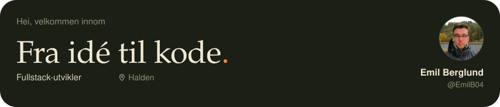
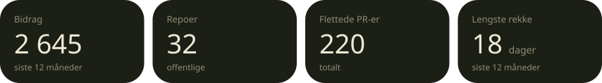
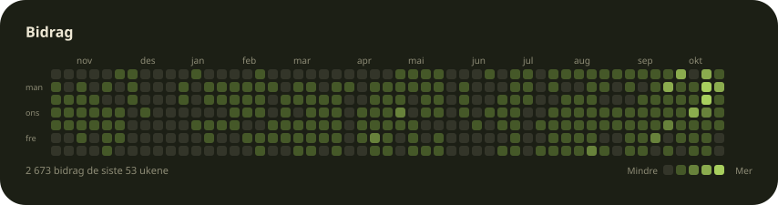
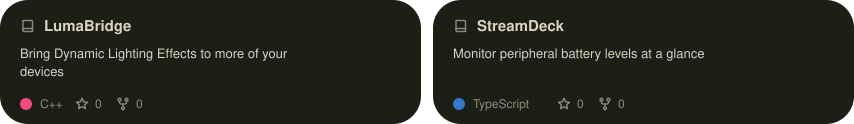
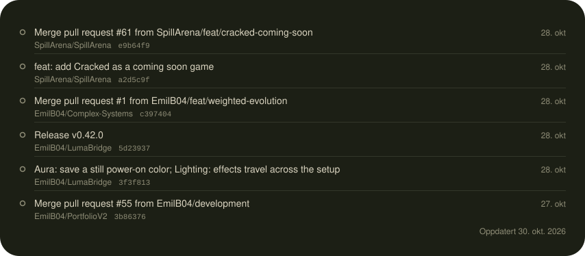

<a href="https://github.com/Emilb04"><picture><source media="(max-width: 480px)" srcset="./assets/hero-nl3XsBSs-phone.svg" /><source media="(max-width: 768px)" srcset="./assets/hero-nl3XsBSs-tablet.svg" /></picture></a>

Jeg lager verktøy for weben og deler det jeg lærer underveis. Under finner du prosjektene jeg jobber med akkurat nå, og hva jeg har pushet den siste tiden.

[Prosjekter](#prosjekter)&emsp;[Siste aktivitet](#siste-aktivitet)

<picture><source media="(max-width: 480px)" srcset="./assets/metrics-66H31D_7-phone.svg" /><source media="(max-width: 768px)" srcset="./assets/metrics-66H31D_7-tablet.svg" /></picture>

<picture><source media="(max-width: 480px)" srcset="./assets/contributions-CjZ_L4ae-phone.svg" /><source media="(max-width: 768px)" srcset="./assets/contributions-CjZ_L4ae-tablet.svg" /></picture>

### Prosjekter

<picture><source media="(max-width: 480px)" srcset="./assets/projects-pjfxjFLP-phone.svg" /><source media="(max-width: 768px)" srcset="./assets/projects-pjfxjFLP-tablet.svg" /></picture>

[LumaBridge](https://github.com/EmilB04/LumaBridge) · [StreamDeck](https://github.com/EmilB04/StreamDeck)

### Siste aktivitet

<a href="https://github.com/Emilb04"><picture><source media="(max-width: 480px)" srcset="./assets/activity-k_v39XOF-phone.svg" /><source media="(max-width: 768px)" srcset="./assets/activity-k_v39XOF-tablet.svg" /></picture></a>

### Verktøy

